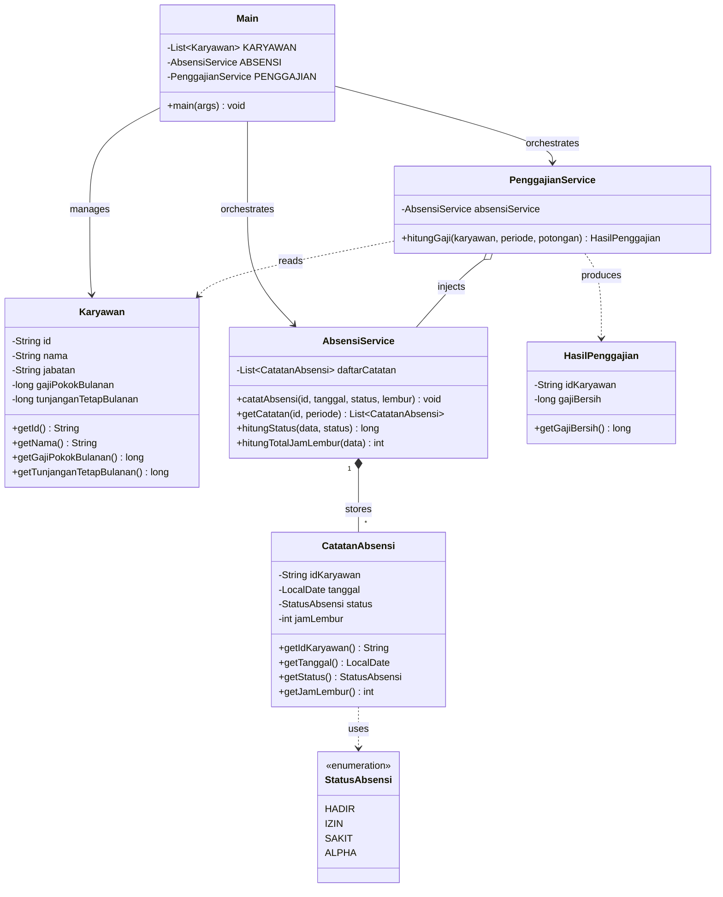

# Dokumentasi Proyek: Sistem Absensi dan Penggajian Karyawan

> Mata Kuliah: Pemrograman Berorientasi Objek (Object-Oriented Programming / OOP)  
> Bahasa dan Platform: Java 17+ (Standard Library murni tanpa external framework)  
> Metode Pengerjaan: Kolaborasi Tim Terdistribusi berbasis Git dan Code Review (Pull Request)

## Tim Pengembang dan Kontributor Modul

| Nama Mahasiswa | Peran dan Modul Utama | File yang Dikelola | Fokus Kontribusi |
|---|---|---|---|
| **Ilham Sepriyadi** | **Koordinator Proyek dan Lead Integrator**<br>Modul `employee`<br>Modul `app` (CLI) | `employee/Karyawan.java`<br>`app/Main.java`<br>`docs/` (Arsitektur dan Integrasi) | Merancang fondasi data master karyawan, orkestrasi integrasi antarmodul, antarmuka konsol interaktif (CLI), validasi input terminal, dan automated test suite `SystemTest.java`. |
| **Muhammad Andriansyah** | **Payroll Specialist**<br>Modul `payroll` | `payroll/HasilPenggajian.java`<br>`payroll/PenggajianService.java` | Merancang logika perhitungan kompensasi bulanan, proporsional potongan Alpha (standar 26 hari kerja), kalkulasi upah lembur, proteksi gaji bersih non-negatif, dan DTO hasil slip gaji. |
| **Ade Rizky** | **Attendance Specialist**<br>Modul `attendance` | `attendance/StatusAbsensi.java`<br>`attendance/CatatanAbsensi.java`<br>`attendance/AbsensiService.java` | Merancang enum status presensi, model catatan kehadiran, validasi aturan bisnis jam lembur (hanya untuk status `HADIR`), dan mekanisme anti-duplikasi absensi harian per karyawan. |

## 1. Latar Belakang dan Filosofi Desain

Proyek ini dibangun untuk menyelesaikan persoalan nyata dalam pencatatan kehadiran karyawan dan kalkulasi penggajian bulanan di lingkungan kerja. Sebagai mahasiswa teknik informatika atau ilmu komputer, kami memandang tugas ini bukan sekadar tugas membuat program yang asal jalan, melainkan sarana menguji bagaimana prinsip rekayasa perangkat lunak modern dan Pemrograman Berorientasi Objek (OOP) dapat diterapkan secara disiplin dalam kerja tim.

### Mengapa Memilih Java Murni Tanpa Framework?
Seringkali mahasiswa terburu-buru menggunakan framework (seperti Spring Boot atau dependensi eksternal) sebelum memahami fundamental bahasa. Dalam proyek ini, kami bersepakat menggunakan Java Standard Library murni (JDK 17+). Dengan demikian, kami benar-benar mengimplementasikan konsep:
1. Encapsulation dan Immutability secara manual pada setiap class model.
2. Manual Dependency Injection melalui constructor tanpa sihir otomatis (*no framework magic*).
3. Java Modern Time API (`java.time.*`) seperti `LocalDate` dan `YearMonth` untuk mengelola tanggal kalender secara presisi.
4. Java Stream API untuk operasi filter, counting, dan sorting riwayat data di memori secara fungsional dan deklaratif.

> **Diskusi Kolaborasi Tim : Saat Kickoff Proyek**
> - **Ilham Sepriyadi:** *"Teman-teman, untuk proyek ini kita jangan pakai library aneh-aneh dulu. Kita kuatin konsep OOP-nya. Struktur package kita bagi per fitur domain, dan setiap modul harus berdiri tegak dengan validasinya sendiri."*
> - **Muhammad Andriansyah:** *"Sepakat Ham. Di modul payroll, nanti gw butuh data absensi dari Ade. Tapi gw gak mau modul payroll manggil langsung Scanner konsol atau tahu urusan input user. Cukup lempar objek Karyawan sama periode, biar payroll murni proses kalkulasi matematika bisnis."*
> - **Ade Rizky:** *"Mantap. Di modul absensi juga gw bakal kunci supaya satu karyawan gak bisa absen dua kali di tanggal yang sama. Jadi data yang masuk ke Andri dijamin udah bersih dan valid."*

## 2. Arsitektur Kode: Alasan Pemilihan Package-by-Feature

Struktur package proyek kami disusun dengan pendekatan Package-by-Feature (Domain-Driven):

```text
id.kelompok.absensigaji/
├── app/          # Antarmuka CLI dan Orchestrator (Ilham)
├── employee/     # Domain data master karyawan (Ilham)
├── attendance/   # Domain pencatatan dan riwayat kehadiran (Ade)
└── payroll/      # Domain kalkulasi kompensasi dan penggajian (Andriansyah)
```

### Mengapa Bukan Package-by-Layer?
Pada pendekatan tradisional (Package-by-Layer), folder dibagi menjadi `model/`, `service/`, dan `controller/`. Untuk kerja kolaboratif 3 orang, pola tersebut memiliki kelemahan besar:
1. Merge Conflict Tinggi: Ketika Ade membuat model absensi dan Andri membuat model payroll di folder `model/` yang sama, potensi tabrakan commit di Git sangat tinggi.
2. Keterikatan Lemah (Low Cohesion): Berkas-berkas yang saling berkaitan tersebar berjauhan.

Dengan Package-by-Feature:
- Ade Rizky memiliki kepemilikan penuh atas package `attendance/`.
- Muhammad Andriansyah memiliki kepemilikan penuh atas package `payroll/`.
- Ilham Sepriyadi menghubungkan keduanya melalui `app/` dan menyediakan master model di `employee/`.
- Tiap modul memiliki batas tanggung jawab (boundary) yang tegas, sehingga kami dapat bekerja secara paralel di branch Git masing-masing tanpa saling menimpa kode.

## 3. Penerapan Pilar dan Konsep OOP Secara Konkret

Berikut adalah bagaimana pilar-pilar OOP diimplementasikan secara nyata dalam kode kami:



### A. Enkapsulasi dan Immutability (Data Hiding)
Seluruh class model (`Karyawan`, `CatatanAbsensi`, dan `HasilPenggajian`) menerapkan enkapsulasi tingkat tinggi:
- Semua atribut dideklarasikan `private final`.
- Tidak ada method setter. Objek yang telah dibuat tidak dapat dimutasi nilainya dari luar (immutable).
- Hal ini menghindarkan terjadinya efek samping (side effects), di mana data karyawan atau riwayat absensi diubah secara tidak sengaja oleh modul lain saat proses kalkulasi sedang berjalan.

### B. Type Safety dengan Java Enum
Dalam modul absensi, status kehadiran tidak disimpan sebagai teks String bebas, melainkan menggunakan `enum StatusAbsensi`:
- Menghilangkan potensi bug akibat salah ketik (misalnya: "Hadir", "hadir", "HDR").
- Memudahkan pencabangan logika di `PenggajianService` dan menu `Main` menggunakan fitur switch ekspresi modern di Java.

### C. Separation of Concerns (Pemisahan Tanggung Jawab)
- `CatatanAbsensi` hanya bertanggung jawab memvalidasi dirinya sendiri (misal: lembur hanya boleh diisi jika hadir).
- `AbsensiService` bertindak sebagai manajer repositori riwayat; ia bertanggung jawab mengecek apakah sudah ada data pada tanggal yang sama (anti-duplikasi).
- `PenggajianService` murni mengurus formula matematika penggajian. Ia tidak tahu bagaimana terminal membaca input pengguna.

### D. Manual Dependency Injection (DI)
Perhatikan hubungan antara `PenggajianService` dan `AbsensiService`:
```java
// Di dalam PenggajianService.java
private final AbsensiService absensiService;

public PenggajianService(AbsensiService absensiService) {
    this.absensiService = absensiService;
}
```
Class `PenggajianService` tidak memanggil `new AbsensiService()` di dalam dirinya sendiri. Instance `AbsensiService` disuntikkan (injected) dari luar melalui constructor di `Main.java`:
```java
// Di dalam Main.java
private static final AbsensiService ABSENSI = new AbsensiService();
private static final PenggajianService PENGGAJIAN = new PenggajianService(ABSENSI);
```

Keuntungan pola ini:
1. Loose Coupling: Modul payroll tidak terikat pada cara pembuatan modul absensi.
2. Testability: Mempermudah pengujian unit (unit testing), karena kita dapat memberikan instance absensi yang terisolasi dengan data uji yang terkontrol.

## 4. Bedah Modul dan Walkthrough Kode Bersama Tim

Berikut ulasan mendalam tiap modul beserta catatan kolaborasi dan diskusi antaranggota saat menyusun kodenya:

### 4.1 Modul Employee: `Karyawan.java`
Penanggung Jawab: Ilham Sepriyadi

`Karyawan.java` menjadi entitas inti sistem. Class ini merepresentasikan seorang pekerja dengan identitas dan informasi kompensasi dasarnya.

```java
public class Karyawan {
    private final String id;
    private final String nama;
    private final String jabatan;
    private final long gajiPokokBulanan;       // Tipe 'long' untuk mencegah error aproksimasi desimal
    private final long tunjanganTetapBulanan;

    public Karyawan(String id, String nama, String jabatan,
                    long gajiPokokBulanan, long tunjanganTetapBulanan) {
        if (id == null || id.isBlank()) throw new IllegalArgumentException("ID karyawan tidak boleh kosong.");
        if (nama == null || nama.isBlank()) throw new IllegalArgumentException("Nama karyawan tidak boleh kosong.");
        if (jabatan == null || jabatan.isBlank()) throw new IllegalArgumentException("Jabatan tidak boleh kosong.");
        if (gajiPokokBulanan < 0 || tunjanganTetapBulanan < 0) {
            throw new IllegalArgumentException("Gaji pokok dan tunjangan tidak boleh bernilai negatif.");
        }
        this.id = id.trim();
        this.nama = nama.trim();
        this.jabatan = jabatan.trim();
        this.gajiPokokBulanan = gajiPokokBulanan;
        this.tunjanganTetapBulanan = tunjanganTetapBulanan;
    }
    // Getter methods...
}
```

> **Catatan Kolaborasi : Code Review Modul Employee**
> - **Muhammad Andriansyah:** *"Ham, pilihan pakai `long` buat nominal uang udah tepat banget. Waktu semester lalu bikin aplikasi kasir pakai `double`, ada selisih `0.000000001` gara-gara keterbatasan representasi biner floating-point IEEE 754. Dengan `long`, nilai rupiah bulat terjamin presisi."*
> - **Ade Rizky:** *"Validasi `isBlank()` dan `trim()` di constructor ini nolong banget, Ham. Jadi waktu karyawan diinput dengan spasi berlebih atau ID kosong di menu CLI, sistem langsung nolak sebelum masuk ke database memori kita."*
> - **Ilham Sepriyadi:** *"Sip! Karena ini data master, gw pastikan seluruh atributnya `final`. Sekali di-instansiasi, gak ada method setter yang bisa seenaknya ngubah gaji pokok atau ID di tengah jalan."*

### 4.2 Modul Attendance: `CatatanAbsensi.java` dan `AbsensiService.java`
Penanggung Jawab: Ade Rizky

Modul ini bertanggung jawab mencatat presensi harian karyawan, memvalidasi aturan kehadiran, dan mengelola riwayat pencatatan.

#### A. Aturan Bisnis Jam Lembur pada `CatatanAbsensi.java`
```java
public CatatanAbsensi(String idKaryawan, LocalDate tanggal, StatusAbsensi status, int jamLembur) {
    // Validasi parameter null & nilai negatif...
    if (status != StatusAbsensi.HADIR && jamLembur != 0) {
        throw new IllegalArgumentException("Jam lembur hanya dapat dicatat untuk status HADIR.");
    }
    this.jamLembur = jamLembur;
}
```

#### B. Logika Anti-Duplikasi pada `AbsensiService.java`
```java
public void catatAbsensi(String idKaryawan, LocalDate tanggal, StatusAbsensi status, int jamLembur) {
    if (idKaryawan == null || idKaryawan.isBlank()) {
        throw new IllegalArgumentException("ID karyawan tidak boleh kosong.");
    }
    // Cek apakah karyawan ini sudah pernah mencatat absensi di tanggal yang sama
    boolean sudahAda = daftarCatatan.stream().anyMatch(item ->
            item.getIdKaryawan().equalsIgnoreCase(idKaryawan.trim())
                    && item.getTanggal().equals(tanggal));
    if (sudahAda) {
        throw new IllegalArgumentException("Absensi karyawan pada tanggal tersebut sudah ada.");
    }
    daftarCatatan.add(new CatatanAbsensi(idKaryawan, tanggal, status, jamLembur));
}
```

> **Catatan Kolaborasi : Diskusi Modul Attendance**
> - **Ade Rizky:** *"Ham, Ndri, sempat kepikiran apakah validasi tanggal duplikat ditaruh di dalam constructor `CatatanAbsensi` aja. Tapi setelah gw pikir-pikir ulang, class `CatatanAbsensi` itu cuma sebuah rekaman (record) satuan, dia gak tahu riwayat rekaman lainnya. Makanya validasi tanggal kembar gw taruh di `AbsensiService` yang megang `List<CatatanAbsensi>`."*
> - **Ilham Sepriyadi:** *"Keputusan desain yang sangat pas, De! Itu sesuai prinsip Single Responsibility Principle (SRP) dan High Cohesion. Biarkan entitas mengurus dirinya sendiri, dan service yang mengurus integritas koleksi."*
> - **Muhammad Andriansyah:** *"Logika lembur hanya untuk status `HADIR` itu brilian, De. Jadi waktu gw ngitung total upah lembur di payroll, gw gak perlu khawatir ada data aneh seperti orang sakit tapi dapet uang lembur."*

### 4.3 Modul Payroll: `HasilPenggajian.java` dan `PenggajianService.java`
Penanggung Jawab: Muhammad Andriansyah

Modul penggajian memproses kalkulasi kompensasi finansial bulanan berdasarkan rekapitulasi kehadiran dari modul Ade dan data master dari modul Ilham.

#### A. Implementasi Business Logic Penggajian
```java
public HasilPenggajian hitungGaji(Karyawan karyawan, YearMonth periode, long potonganTambahan) {
    if (karyawan == null || periode == null) {
        throw new IllegalArgumentException("Karyawan dan periode wajib diisi.");
    }
    if (potonganTambahan < 0) {
        throw new IllegalArgumentException("Potongan tambahan tidak boleh negatif.");
    }

    // 1. Ambil rekapan kehadiran dari AbsensiService milik Ade
    List<CatatanAbsensi> records = absensiService.getCatatan(karyawan.getId(), periode);
    int hadir = (int) absensiService.hitungStatus(records, StatusAbsensi.HADIR);
    int izin = (int) absensiService.hitungStatus(records, StatusAbsensi.IZIN);
    int sakit = (int) absensiService.hitungStatus(records, StatusAbsensi.SAKIT);
    int alpha = (int) absensiService.hitungStatus(records, StatusAbsensi.ALPHA);
    int totalJamLembur = absensiService.hitungTotalJamLembur(records);

    // 2. Kalkulasi komponen finansial
    long potonganAlpha = Math.round((double) karyawan.getGajiPokokBulanan()
            / HARI_KERJA_STANDAR * alpha);
    long upahLembur = (long) totalJamLembur * TARIF_LEMBUR_PER_JAM;
    long totalPendapatan = karyawan.getGajiPokokBulanan()
            + karyawan.getTunjanganTetapBulanan() + upahLembur;
    long totalPotongan = potonganAlpha + potonganTambahan;

    // 3. Proteksi gaji bersih non-negatif
    long gajiBersih = Math.max(0L, totalPendapatan - totalPotongan);

    return new HasilPenggajian(
            karyawan.getId(), karyawan.getNama(), periode.toString(),
            hadir, izin, sakit, alpha, totalJamLembur,
            karyawan.getGajiPokokBulanan(), karyawan.getTunjanganTetapBulanan(),
            upahLembur, potonganAlpha, potonganTambahan, gajiBersih);
}
```

> **Catatan Kolaborasi : Diskusi Modul Payroll**
> - **Muhammad Andriansyah:** *"Di formula potongan alpha, gw pakai pembagi standar 26 hari kerja: `Math.round((double) gajiPokok / 26 * alpha)`. Kenapa pembagiannya di-casting ke `double` dulu baru di-round? Supaya pembagian integer Java gak langsung memotong desimal (*truncating*) sebelum dikalikan dengan hari alpha."*
> - **Ilham Sepriyadi:** *"Cerdas, Ndri! Dan gw suka bagian `Math.max(0L, totalPendapatan - totalPotongan)`. Di dunia nyata, kalau karyawan punya potongan denda gede atau alpha sebulan penuh, slip gajinya gak boleh bernilai minus sampai perusahaan yang nagih ke karyawan wkwk. Minimal gajinya Rp0."*
> - **Ade Rizky:** *"Hasil kalkulasi yang lu bungkus rapi di DTO `HasilPenggajian` juga enak banget dibaca, Ilham di Main tinggal panggil getter masing-masing komponen buat cetak slip gajinya."*

### 4.4 Modul App: `Main.java` (Orchestrator Antarmuka CLI)
Penanggung Jawab: Ilham Sepriyadi

`Main.java` adalah dirigen yang menghubungkan ketiga modul. Tugas penting di modul konsol adalah memastikan aplikasi tidak crash akibat input pengguna yang keliru (misalnya salah ketik format tanggal atau memasukkan huruf di kolom angka).

```java
// Contoh helper parsing tangguh di Main.java
private static long bacaLongNonNegatif(String prompt) {
    while (true) {
        try {
            long nilai = Long.parseLong(bacaTeks(prompt));
            if (nilai >= 0) return nilai;
        } catch (NumberFormatException ignored) {
            // Ditangkap agar looping terus berlanjut tanpa crash
        }
        System.out.println("Masukkan bilangan bulat nol atau lebih.");
    }
}
```

> **Catatan Kolaborasi : Review Integrasi CLI**
> - **Ilham Sepriyadi:** *"Di `Main.java`, semua input tanggal dan angka gw bungkus pakai helper loop with exception handling (`DateTimeParseException`, `NumberFormatException`). Terus waktu manggil method Ade dan Andri, kalau ada `IllegalArgumentException`, bakal gw catch dan print pesan ramah ke pengguna tanpa memutus jalannya program."*
> - **Ade Rizky:** *"Iya Ham, kerasa banget waktu nyoba input tanggal salah format `2026-13-45`, program gak langsung merah melempar stack trace jelek di layar, tapi ngasih tau format yang bener."*
> - **Muhammad Andriansyah:** *"Menu interaktifnya juga urut dan jelas: input karyawan dulu, catat absensi, cek riwayat, baru kalkulasi slip gaji."*

## 5. Bedah Rumus dan Studi Kasus Simulasi Penggajian

Aturan bisnis simulasi penggajian disepakati dengan parameter berikut:
1. Hari Kerja Standar Bulanan: 26 hari.
2. Formula Potongan Alpha:
   $$\text{Potongan Alpha} = \text{round}\left(\frac{\text{Gaji Pokok}}{26}\right) \times \text{Jumlah Hari Alpha}$$
3. Izin dan Sakit: Tidak memotong gaji pokok maupun tunjangan (kebijakan simulasi akademik).
4. Tarif Upah Lembur: $\text{Jumlah Jam Lembur} \times \text{Rp20.000}$ (hanya sah diperoleh pada tanggal berstatus `HADIR`).
5. Gaji Bersih (Take Home Pay):
   $$\text{Gaji Bersih} = \max\Big(0, \; (\text{Gaji Pokok} + \text{Tunjangan Tetap} + \text{Upah Lembur}) - (\text{Potongan Alpha} + \text{Potongan Tambahan})\Big)$$

### Studi Kasus 1: Perhitungan Normal Karyawan (Sdr. Budi, Staff IT)
- Data Karyawan:
  - Gaji Pokok = Rp3.000.000
  - Tunjangan Tetap = Rp300.000
- Rekap Absensi (Periode Oktober 2026):
  - Hadir = 20 hari
  - Jam Lembur = 5 jam
  - Izin = 1 hari
  - Sakit = 1 hari
  - Alpha = 2 hari
- Potongan Tambahan (Kas atau Koperasi): Rp50.000

#### Langkah Hitung Manual:
1. Kompensasi Lembur:
   $$\text{Upah Lembur} = 5 \times \text{Rp20.000} = \text{Rp100.000}$$
2. Potongan Ketidakhadiran (Alpha):
   $$\text{Potongan Alpha} = \text{round}\left(\frac{3.000.000}{26}\right) \times 2 = 115.385 \times 2 = \text{Rp230.769}$$
3. Total Pendapatan Kotor (Bruto):
   $$\text{Total Pendapatan} = 3.000.000 + 300.000 + 100.000 = \text{Rp3.400.000}$$
4. Total Seluruh Potongan:
   $$\text{Total Potongan} = 230.769 + 50.000 = \text{Rp280.769}$$
5. Gaji Bersih Diterima:
   $$\text{Gaji Bersih} = 3.400.000 - 280.769 = \mathbf{\text{Rp3.119.231}}$$

Hasil perhitungan manual di atas terbukti identik hingga satuan rupiah terakhir dengan keluaran sistem pada test case TC-11.

### Studi Kasus 2: Penanganan Kasus Ekstrem (Potongan Melebihi Pendapatan)
- Data Karyawan: Gaji Pokok = Rp2.000.000, Tunjangan = Rp0.
- Absensi: 15 hari Alpha, 0 lembur.
- Potongan Tambahan: Rp1.500.000 (Denda kerusakan aset).

#### Langkah Hitung Manual:
1. Potongan Alpha:
   $$\text{round}\left(\frac{2.000.000}{26}\right) \times 15 = 76.923 \times 15 = \text{Rp1.153.846}$$
2. Total Potongan:
   $$1.153.846 + 1.500.000 = \text{Rp2.653.846}$$
3. Kalkulasi Bersih Sebelum Proteksi:
   $$2.000.000 - 2.653.846 = -\text{Rp653.846}$$
4. Eksekusi Proteksi Non-Negatif:
   $$\text{Gaji Bersih} = \max(0, -653.846) = \mathbf{\text{Rp0}}$$

Sistem berhasil mencegah angka negatif dan menetapkan gaji bersih Rp0 sesuai skenario TC-13.

## 6. Verifikasi dan Otomasi Pengujian (15 Test Cases)

Sebagai bukti profesionalisme kerja tim, kami tidak hanya menguji aplikasi dengan cara mengetik manual di terminal berulang kali, tetapi juga membangun Automated Test Suite pada class [SystemTest.java](file:///home/ilhamspryd/College/Object%20Oriented%20Programming/tugas/tugas-oop-sistemPenggajianKaryawan/src/test/java/id/kelompok/absensigaji/SystemTest.java).

| ID Uji | Modul | Skenario Pengujian | Hasil yang Diharapkan | Status | Verifikator |
|---|---|---|---|---|---|
| **TC-01** | Employee | Tambah karyawan dengan data valid | Objek terbuat lengkap dan tersimpan di memori | **LULUS** | Ilham Sepriyadi |
| **TC-02** | Employee | Tambah karyawan dengan ID duplikat | Input kedua ditolak dengan pesan peringatan | **LULUS** | Ilham Sepriyadi |
| **TC-03** | Employee | Tambah karyawan dengan nilai gaji negatif | Melempar `IllegalArgumentException` | **LULUS** | Ilham Sepriyadi |
| **TC-04** | Attendance | Catat absensi HADIR dengan jam lembur | Catatan tersimpan dengan status HADIR dan lembur | **LULUS** | Ade Rizky |
| **TC-05** | Attendance | Catat absensi non-HADIR dengan lembur 0 | Catatan tersimpan dengan status IZIN/SAKIT/ALPHA | **LULUS** | Ade Rizky |
| **TC-06** | Attendance | Catat absensi non-HADIR tetapi lembur > 0 | Ditolak: lembur hanya sah untuk status HADIR | **LULUS** | Ade Rizky |
| **TC-07** | Attendance | Catat absensi duplikat pada tanggal yang sama | Ditolak: absensi tanggal tersebut sudah ada | **LULUS** | Ade Rizky |
| **TC-08** | Attendance | Catat absensi dengan format tanggal keliru | Ditangkap oleh penanganan parsing, CLI tidak crash | **LULUS** | Ade Rizky |
| **TC-09** | Attendance | Query riwayat absensi berdasarkan ID dan periode | Riwayat terfilter akurat dan terurut tanggal | **LULUS** | Ade Rizky |
| **TC-10** | Payroll | Hitung gaji: kehadiran penuh tanpa lembur | Gaji pokok dan tunjangan dibayarkan penuh | **LULUS** | Muhammad Andriansyah |
| **TC-11** | Payroll | Hitung gaji: ada lembur dan potongan Alpha | Komponen dihitung akurat (gaji bersih Rp3.119.231) | **LULUS** | Muhammad Andriansyah |
| **TC-12** | Payroll | Hitung gaji: input potongan tambahan negatif | Ditolak dengan `IllegalArgumentException` | **LULUS** | Muhammad Andriansyah |
| **TC-13** | Payroll | Hitung gaji: potongan melebihi pendapatan | Nilai diproteksi `Math.max`, gaji bersih Rp0 | **LULUS** | Muhammad Andriansyah |
| **TC-14** | Payroll | Hitung gaji: periode tanpa data kehadiran | Nilai absensi 0, tidak menyebabkan NullPointerException | **LULUS** | Muhammad Andriansyah |
| **TC-15** | Integrasi | Alur lengkap Karyawan ke Absensi ke Gaji | Data mengalir utuh antarmodul, slip gaji tercetak akurat | **LULUS** | Ilham, Andri, Ade |

Seluruh 15 skenario pengujian berstatus 100% LULUS (15/15).

## 7. Bukti Visual Eksekusi Program (Screenshots)

Bukti hasil running program terminal yang telah diperbarui dan bersih dari karakter dekoratif:

- **Menu Utama:** [`screenshots/01-menu-utama.png`](../screenshots/01-menu-utama.png)
- **Data Karyawan:** [`screenshots/02-tambah-daftar-karyawan.png`](../screenshots/02-tambah-daftar-karyawan.png)
- **Input Absensi:** [`screenshots/03-input-absensi-valid.png`](../screenshots/03-input-absensi-valid.png)
- **Validasi Duplikasi:** [`screenshots/04-validasi-duplikasi-absensi.png`](../screenshots/04-validasi-duplikasi-absensi.png)
- **Riwayat Kehadiran:** [`screenshots/05-riwayat-absensi.png`](../screenshots/05-riwayat-absensi.png)
- **Kalkulasi Slip Gaji:** [`screenshots/06-hasil-kalkulasi-penggajian.png`](../screenshots/06-hasil-kalkulasi-penggajian.png)

## 8. Refleksi Pembelajaran dan Catatan Penutup Mahasiswa

Pengerjaan tugas besar Sistem Penggajian dan Absensi ini memberikan banyak pelajaran berharga di luar sekadar menulis sintaks Java:

### 1. Pelajaran tentang Git dan Kerjasama Tim
Bekerja dalam tim tiga orang mengajarkan kami pentingnya komunikasi kontrak antarmodul sebelum mulai mengetik kode (design-first approach). Dengan menyepakati method signature di awal ([`docs/KONTRAK-ANTARMODUL.md`](KONTRAK-ANTARMODUL.md)), kami bisa ngoding modul masing-masing tanpa harus saling menunggu.

### 2. Pelajaran tentang Defensive Programming
Validasi data bukan hanya tugas form input, tetapi tugas class model itu sendiri. Dengan menjaga agar constructor selalu menolak data cacat (invalid state), bug dapat dicegah sedini mungkin (fail-fast principle).

### 3. Kata Penutup dari Tim:
- **Ilham Sepriyadi:** *"Sebagai koordinator, pengalaman mengintegrasikan modul dari Ade dan Andri membuktikan bahwa arsitektur yang bersih dan pembagian tugas berbasis domain bikin pengerjaan tugas besar jadi sangat terstruktur dan minim stres saat merge branch."*
- **Muhammad Andriansyah:** *"Mendesain modul penggajian membuka mata gw betapa krusialnya presisi tipe data dan penanganan edge case matematika. Kolaborasi bareng Ilham dan Ade bikin logika bisnis yang rumit jadi terasa solid dan teruji."*
- **Ade Rizky:** *"Di modul absensi, gw belajar banyak tentang Stream API dan bagaimana membedakan peran antara entitas tunggal dengan class service pengelola koleksi. Senang banget bisa berkontribusi dalam tim yang komunikatif ini."*
